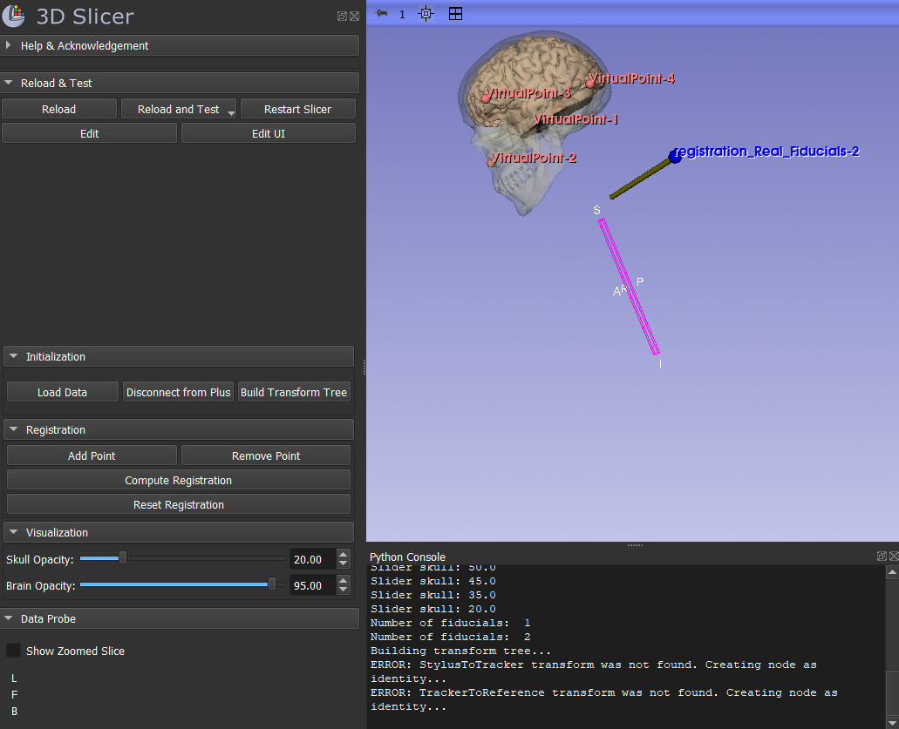
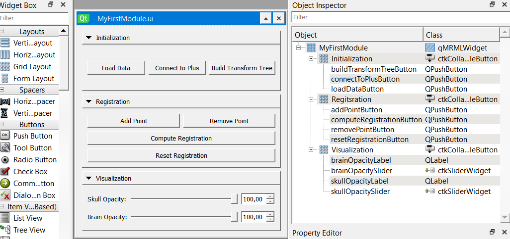
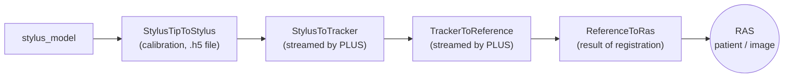

## IGTModules — Fiducial-Based Registration for Surgical Navigation in 3D Slicer

A scripted **3D Slicer** module (`MyFirstModule`) for **image-guided therapy (IGT)**. It loads a virtual patient (skull, brain and tumour models), connects to an optical tracker through **PLUS / OpenIGTLink**, displays a tracked stylus in real time, and registers the physical phantom to the virtual models using **point-based (fiducial) rigid registration**. Once registered, the stylus tip can be used to navigate to the tumour.

Developed for the Laboratory 3 practical session, Department of Bioengineering, Universidad Carlos III de Madrid (UC3M).

> **Note:** this repository contains the module source code and user interface only. The phantom data (3D models, calibration transform and fiducials) was provided by the course and is **not included**. See [Data](#data).

## Skills demonstrated

- Creating a 3D Slicer extension and scripted module with the **Extension Wizard**
- Designing a module GUI in **Qt Designer** (CTK collapsible buttons, push buttons, slider widgets) and connecting it to Python callbacks
- Using the **MRML scene** from Python: loading models, transforms and markups; creating `vtkMRMLLinearTransformNode` and `vtkMRMLMarkupsFiducialNode` nodes
- Real-time tracking through **OpenIGTLink / PLUS** (`vtkMRMLIGTLConnectorNode`)
- Building a **transform hierarchy** to place a tracked tool in patient (RAS) coordinates
- **Point-based rigid registration** with Slicer's Fiducial Registration CLI module and evaluation by RMS error
- Separating GUI (widget class) from computation (logic class), following Slicer's module architecture




---

## Features

The module panel is organised in three collapsible sections:

| Section | Control | What it does |
|---|---|---|
| **Initialization** | Load Data | Loads the stylus, skull, brain and tumour models, the stylus calibration transform and the virtual registration fiducials. Creates the `ReferenceToRas` transform and the `registration_Real_Fiducials` point list. |
| | Connect to Plus | Opens / closes an OpenIGTLink client connection to the PLUS server that streams the tracker transforms. |
| | Build Transform Tree | Chains the tracker transforms so the stylus model follows the real stylus in the patient (RAS) coordinate system. |
| **Registration** | Add Point | Records the current stylus tip position as a new real fiducial. |
| | Remove Point | Deletes the last recorded fiducial. |
| | Compute Registration | Computes the rigid transform that aligns the real fiducials to the virtual ones, stores it in `ReferenceToRas` and prints the RMS error. |
| | Reset Registration | Deletes all real fiducials and resets `ReferenceToRas` to identity. |
| **Visualization** | Skull Opacity / Brain Opacity | Sliders (0–100 %) to make the skull and brain transparent so the tumour becomes visible. |

---

## Transform tree

The stylus model is placed in the patient's coordinate system (RAS) by chaining four transforms:



- **StylusTipToStylus** — fixed pivot calibration of the stylus tip, loaded from file.
- **StylusToTracker** and **TrackerToReference** — live poses of the stylus and of the reference marker attached to the phantom, sent by the optical tracker through PLUS.
- **ReferenceToRas** — unknown at the start (identity); it is computed by the fiducial registration.

---

## Requirements

- [3D Slicer](https://download.slicer.org/) **5.2.1 or later** (stable release)
- **SlicerOpenIGTLink** extension, installed from the Slicer Extensions Manager
- For live navigation: an optical tracker with a reference marker and a tracked stylus, streamed by a **PLUS Server** over OpenIGTLink

---

## Installation

A scripted module does not need to be compiled. 3D Slicer loads it directly from its folder. The module opens without data, but **Load Data** needs the files listed in [Data](#data).

1. Clone or download this repository:
   ```bash
   git clone https://github.com/<your-username>/<your-repository>.git
   ```
2. Open 3D Slicer and go to **Edit → Application Settings → Modules**.
3. In **Additional module paths**, click **»** / **Add** and select the `MyFirstModule` folder of this repository (or drag the folder onto the list).
4. Restart 3D Slicer when prompted.
5. Open the module from the module list: **MyIGTModules → MyFirstModule**.

---

## Usage

1. **Load Data** — the models, the stylus calibration and the red virtual fiducials appear in the scene.
2. **Connect to Plus** — connects to the PLUS server. The default address is `163.117.178.165`, port `18944` (see [Configuration](#configuration)). The button text changes to *Disconnect from Plus*.
3. **Build Transform Tree** — the yellow stylus model now moves with the real stylus.
4. **Add Point** — touch each registration landmark on the phantom with the stylus tip and click *Add Point*. Collect the points **in the same order** as the virtual fiducials (at least 3 non-collinear points; 4 were used in the lab). Use *Remove Point* to discard a wrong point.
5. **Compute Registration** — the RMS error is printed in the Python console (**View → Python Console**). A low RMS error (a few millimetres) indicates a good registration.
6. **Adjust the opacity** of the skull and brain so the green tumour is visible.
7. **Navigate** — touch the tumour in the phantom and check that the stylus tip on screen reaches the same location on the virtual tumour.

> **Tip:** before collecting a new set of points, click **Reset Registration**. Points are recorded in world coordinates, so if `ReferenceToRas` is not identity, new points would already include the previous registration.

---

## Data

The data used in the lab was provided by the course instructors and is **not included** in this repository. To run the module, place your own files with the following names in `MyFirstModule/Resources/Data/`:

| File | Content | Display colour (RGB) |
|---|---|---|
| `stylus_model.stl` | Stylus tool model | [0.96, 0.96, 0.00] yellow |
| `skull_model.stl` | Skull model | [0.80, 0.81, 0.64] bone |
| `brain_model.stl` | Brain model | [0.81, 0.64, 0.52] |
| `tumor_model.stl` | Tumour model | [0.00, 0.99, 0.00] green |
| `StylusTipToStylus.h5` | Stylus tip calibration transform | — |
| `registration_Virtual_Fiducials.fcsv` | Registration landmarks in image space | [1.00, 0.00, 0.00] red |

The data path is resolved automatically from the module location, so no paths need to be edited.

---

## Repository structure

```
IGTModules/                         Repository root
├── README.md
└── MyFirstModule/                  Scripted module
    ├── MyFirstModule.py            Module code (module, widget and logic classes)
    └── Resources/
        ├── UI/MyFirstModule.ui     Qt Designer user interface
        └── Data/                   (not included — see Data)
```

### Code overview

`MyFirstModule.py` follows the standard 3D Slicer scripted-module pattern:

- **`MyFirstModule`** — module metadata (title, category, contributors, help text).
- **`MyFirstModuleWidget`** — loads the `.ui` file and connects each button and slider to a callback (`onLoadDataButtonClicked`, `onComputeRegistrationButtonClicked`, …).
- **`MyFirstModuleLogic`** — does the actual work, independently of the GUI:
  - `loadData()`, `loadModelFromFile()`, `loadTransformFromFile()`, `loadFiducialsFromFile()` — scene set-up
  - `startPlusConnection()` / `stopPlusConnection()` — OpenIGTLink client (`vtkMRMLIGTLConnectorNode`)
  - `buildTransformTree()` — chains transforms with `SetAndObserveTransformNodeID()`
  - `addPoint()` / `removePoint()` — stylus tip position in world coordinates → `registration_Real_Fiducials`
  - `calculateRegistrationAndRMSError()` — runs Slicer's **Fiducial Registration** CLI module (rigid transform, fixed = virtual fiducials, moving = real fiducials) and returns the RMS error
  - `resetRegistration()` — clears the points and sets `ReferenceToRas` to identity
  - `updateSkullModelOpacity()` / `updateBrainModelOpacity()` — model display opacity

---

## Configuration

The PLUS server address is set in `onConnectToPlusButtonClicked()` in `MyFirstModule.py`:

```python
hostname = '163.117.178.165'   # IP address of the PLUS server
port_tracker = 18944           # OpenIGTLink port
```

Change these values to match your own tracking set-up.

---

## Authors

- **Carolina Martín Frisuelos** — Universidad Carlos III de Madrid


## Acknowledgements

Department of Bioengineering, Universidad Carlos III de Madrid. Module template, phantom data and lab instructions provided by the course instructors. Built with [3D Slicer](https://www.slicer.org/), [SlicerOpenIGTLink](https://github.com/openigtlink/SlicerOpenIGTLink) and [PLUS Toolkit](https://plustoolkit.github.io/).